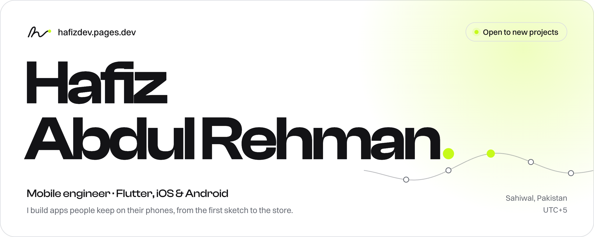
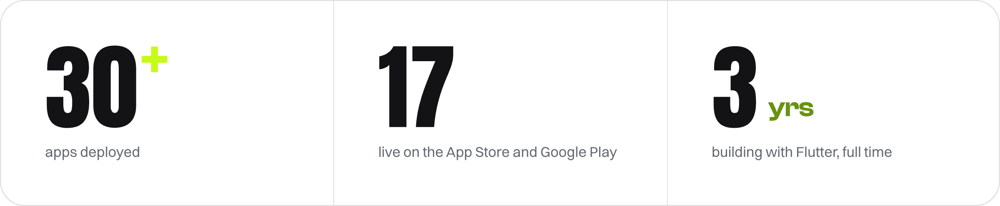
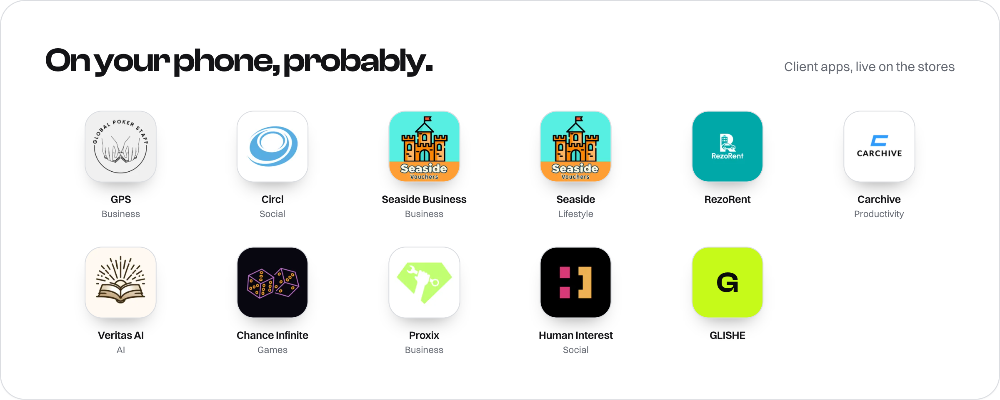
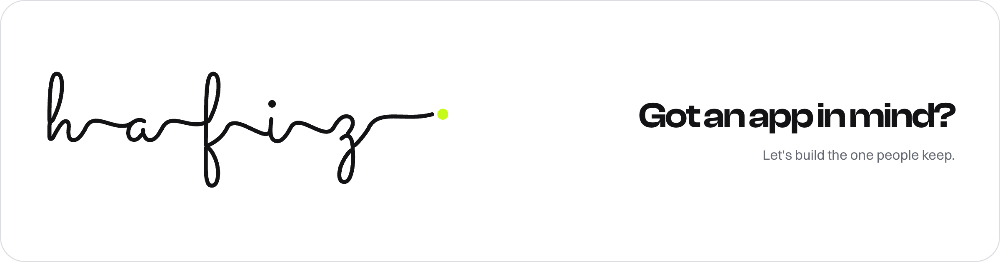

<!--
  Hafiz Abdul Rehman · GitHub profile
  The images come in pairs (…-dark.png / …-light.png) so the page looks right in both of
  GitHub's themes. They're rendered from the portfolio's own fonts and colours by
  scripts/readme/render.cjs in the portfolio repo.
-->

<a href="https://hafizdev.pages.dev">
  <picture>
    <source media="(prefers-color-scheme: dark)" srcset="assets/hero-dark.png">
    <source media="(prefers-color-scheme: light)" srcset="assets/hero-light.png">
    
  </picture>
</a>

  <a href="https://hafizdev.pages.dev"><b>Portfolio</b></a>
  &nbsp;·&nbsp;
  <a href="https://www.linkedin.com/in/hafizargfx/">LinkedIn</a>
  &nbsp;·&nbsp;
  <a href="https://www.instagram.com/hafiz.dev">Instagram</a>
  &nbsp;·&nbsp;
  <a href="mailto:arhafiz0325@gmail.com">Email</a>
  &nbsp;·&nbsp;
  <a href="https://wa.me/923103534778">WhatsApp</a>

 

I'm a mobile engineer in Sahiwal, Pakistan. For close to three years I've built Flutter apps full time, and **17 of them are live on the App Store and Google Play**.

Most apps worth building have a hard part in the middle: payments that have to settle, a ride that has to be tracked live, a backend that has to hold it all together. I've built each of those. I design in Figma before I write code, and I can pick up an app someone else started and carry it forward.

 

<picture>
  <source media="(prefers-color-scheme: dark)" srcset="assets/stats-dark.png">
  <source media="(prefers-color-scheme: light)" srcset="assets/stats-light.png">
  
</picture>

  

## The hard parts, handled

<table>
  <tr>
    <td width="50%" valign="top"><b>Real-time that holds</b> Socket.IO with acknowledged events and automatic reconnects</td>
    <td width="50%" valign="top"><b>Payments that settle</b> Stripe, and Stripe Connect's embedded onboarding</td>
  </tr>
  <tr>
    <td valign="top"><b>Maps that move</b> Google Maps and live navigation</td>
    <td valign="top"><b>A backend to match</b> Firebase, Supabase, REST APIs</td>
  </tr>
  <tr>
    <td valign="top"><b>Code I didn't write</b> Taking over an unfamiliar codebase and carrying it on</td>
    <td valign="top"><b>All the way to the store</b> Builds, TestFlight, review, and the fixes after launch</td>
  </tr>
</table>

 

## Selected work

**[FasoRide](https://hafizdev.pages.dev/work/fasoride)** · *Ride-hailing and delivery, across three apps* 
One app for customers, one for drivers and one for stores. I worked on the parts that have to be right in real time: the map, the live ride and the money.

**[Kusine](https://hafizdev.pages.dev/work/kusine)** · *Food delivery for restaurants, customers and riders* 
A side for each of the three people in a delivery. I designed the UI and handled the backend integration.

 

<a href="https://hafizdev.pages.dev/work">
  <picture>
    <source media="(prefers-color-scheme: dark)" srcset="assets/apps-dark.png">
    <source media="(prefers-color-scheme: light)" srcset="assets/apps-light.png">
    
  </picture>
</a>

<b>Store links</b>

 

| App | What it is | Get it |
| :-- | :-- | :-- |
| **GPS** | Staff attendance, sign-ins and shift tracking for poker events | [App&nbsp;Store](https://apps.apple.com/us/app/global-poker-staff-gps/id6749879138) · [Google&nbsp;Play](https://play.google.com/store/apps/details?id=com.jeuxdevelopers.gps) |
| **Circl** | Swipe to connect and chat with professionals nearby | [App&nbsp;Store](https://apps.apple.com/vn/app/the-circl/id6752708925) |
| **Seaside Business** | Business side of a voucher and leisure property marketplace | [Google&nbsp;Play](https://play.google.com/store/apps/details?id=com.jeuxdevelopers.SeasideBusiness) |
| **Seaside** | Browse discount vouchers and leisure property listings near you | [Google&nbsp;Play](https://play.google.com/store/apps/details?id=com.jeuxdevelopers.SeasideUser) |
| **RezoRent** | | [App&nbsp;Store](https://apps.apple.com/us/app/rezorent/id6756568903) · [Google&nbsp;Play](https://play.google.com/store/apps/details?id=com.jeuxdevelopers.rezorent) |
| **Carchive** | Fleet management for vehicles, drivers and workshops | [App&nbsp;Store](https://apps.apple.com/us/app/carchive/id6505065589) · [Google&nbsp;Play](https://play.google.com/store/apps/details?id=com.carchivedevelopers.carchive) |
| **Veritas AI** | Scripture-based AI chat for questions, worries and prayers | [App&nbsp;Store](https://apps.apple.com/us/app/veritas-ai/id6686409402) |
| **Chance Infinite** | Free sweepstakes where tasks earn tickets for cash prizes | [App&nbsp;Store](https://apps.apple.com/us/app/chance-infinite/id6738285609) |
| **Proxix** | Job platform connecting customers, professionals and administrators | [App&nbsp;Store](https://apps.apple.com/us/app/proxix/id6754624473) · [Google&nbsp;Play](https://play.google.com/store/apps/details?id=com.jeuxdevelopers.proxix_app) |
| **Human Interest** | City and interest-based communities for people who share passions | [App&nbsp;Store](https://apps.apple.com/us/app/human-interest-app/id6758516908) |
| **GLISHE** | | [App&nbsp;Store](https://apps.apple.com/us/app/glishe/id6756303768) |

 

## Toolbox

<picture>
  <source media="(prefers-color-scheme: dark)" srcset="https://skillicons.dev/icons?i=flutter,dart,firebase,supabase,figma,androidstudio,swift,kotlin,py,ts,react,gcp,git,postman,sqlite&perline=15&theme=dark">
  <source media="(prefers-color-scheme: light)" srcset="https://skillicons.dev/icons?i=flutter,dart,firebase,supabase,figma,androidstudio,swift,kotlin,py,ts,react,gcp,git,postman,sqlite&perline=15&theme=light">
  
</picture>

  

<table>
  <tr><td width="190"><b>Mobile</b></td><td>Flutter · Dart · Android · iOS · Platform channels · FCM · Deep links</td></tr>
  <tr><td width="190"><b>Architecture</b></td><td>MVVM · Clean Architecture · Repository pattern · GetX · BLoC</td></tr>
  <tr><td width="190"><b>Backend and data</b></td><td>REST APIs · Socket.IO · Firebase · Supabase · SQLite</td></tr>
  <tr><td width="190"><b>Integrations</b></td><td>Stripe · Stripe Connect · Google Maps · In-app chat · In-app ads</td></tr>
  <tr><td width="190"><b>Tools</b></td><td>Figma · Xcode · Android Studio · Git · Postman · TestFlight</td></tr>
</table>

 

## How a project goes

<table>
  <tr><td align="center">01</td><td width="110"><b>Talk</b></td><td>You tell me the idea. We work out who it's for, what it has to do first, and what can wait.</td></tr>
  <tr><td align="center">02</td><td width="110"><b>Design</b></td><td>I design the screens in Figma, so you can tap through the app before any code exists.</td></tr>
  <tr><td align="center">03</td><td width="110"><b>Build</b></td><td>One Flutter codebase for iOS and Android, with test builds on your phone as it grows.</td></tr>
  <tr><td align="center">04</td><td width="110"><b>Launch</b></td><td>I handle the store side: production builds, TestFlight, review and submission.</td></tr>
  <tr><td align="center">05</td><td width="110"><b>Stay</b></td><td>I stay on for the fixes that only show up once real people start using it.</td></tr>
</table>

 

> [!TIP]
> There's a small lime ghost called **Haffy** living in the corner of [my portfolio](https://hafizdev.pages.dev). He answers questions about working with me. He's also extremely sarcastic. Throw him around; he likes it. Mostly.

 

<a href="https://hafizdev.pages.dev/#contact">
  <picture>
    <source media="(prefers-color-scheme: dark)" srcset="assets/sign-dark.png">
    <source media="(prefers-color-scheme: light)" srcset="assets/sign-light.png">
    
  </picture>
</a>

BS Computer Science at PMAS-Arid Agriculture University, Sahiwal (2028) · Urdu and English

